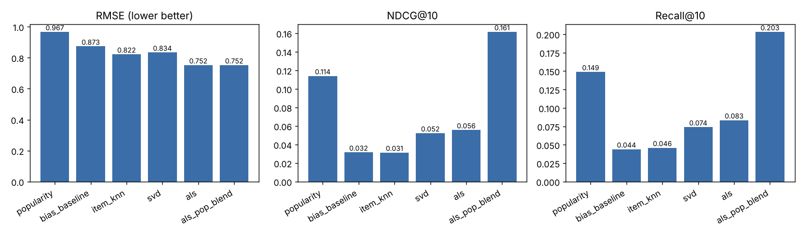
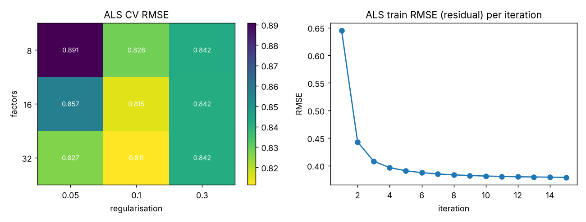
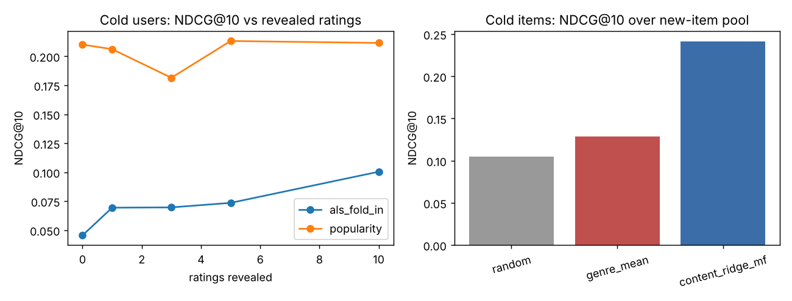

# Movie Recommendation Engine

Popularity, item-item collaborative filtering, truncated SVD and a from-scratch NumPy ALS matrix factorisation, compared on RMSE and top-10 ranking metrics, with cold-start handling for new users and new items.

## Problem statement

Given sparse explicit ratings, predict ratings for unseen user-item pairs and rank unseen items for each user. Two questions drive the project: how much do latent-factor models improve rating prediction over simple baselines, and does that carry over to top-N ranking when exposure is biased towards popular items? New users and new items (no ratings) are evaluated separately.

## Highlights

All numbers are from `reports/metrics.json` (held-out warm test ratings, 555 evaluated users; synthetic data).

- ALS reaches test RMSE 0.752 vs 0.967 for the popularity baseline (22.2% lower) and 1.021 for the global mean.
- Rating accuracy does not translate into ranking: popularity scores NDCG@10 0.114 / recall@10 0.149, while plain ALS scores 0.056 / 0.083. Observed ratings in the synthetic data are deliberately popularity-biased.
- A hybrid (z-scored ALS prediction + weighted log popularity) gives NDCG@10 0.161 / recall@10 0.203, the best ranking result.
- Cold items: a ridge model mapping genres/year to ALS factors gives NDCG@10 0.241 vs 0.105 for random.
- Cold users: ALS fold-in NDCG@10 rises from 0.046 (0 ratings) to 0.100 (10 ratings), but stays below popularity (about 0.21) in this setup.

## Data

Synthetic, generated by a seeded script (`src/movierec/data.py`); it is not real data. 800 users, 500 items, 22,455 ratings (density 5.6%). Ratings follow `round(3.3 + b_u + b_i + 0.85 * affinity + noise)` clipped to 1-5, where affinity is the standardised inner product of 6-dimensional latent user and item factors. Item factors are derived from 1-3 genres (12 genres) plus noise, so content is informative for cold start. Which ratings are observed depends on item popularity, user activity and mildly on affinity (not missing at random). `data/ratings.csv` and `data/items.csv` are the generated files.

## Project structure

```
src/movierec/   config, data (generator, splits), models, features, evaluate, train, plots, predict
scripts/run_pipeline.py   single entry point
tests/          unittest suite
reports/        metrics.json, figures/
models/         saved ALS bundle (joblib)
data/           ratings.csv, items.csv
```

## Quickstart

```
pip install -r requirements.txt
python scripts/run_pipeline.py          # about 1 minute on a CPU
python -m unittest discover -s tests -v
PYTHONPATH=src python -m movierec.predict --user 3
PYTHONPATH=src python -m movierec.predict --rated '{"12": 5, "40": 4}'
```

`make install | data | train | test | run` wrap the same commands.

## Methodology

- Split: 20% of ratings of "warm" users and items held out at random; 50 items and 60 users are removed entirely for cold-start evaluation. Training never sees test or cold entries.
- Models: popularity (mean/count), user+item bias model, item-item kNN, TruncatedSVD, biased ALS-WR (observed-entry ridge solves, 15 iterations).
- Hyperparameters (ALS factors/regularisation, SVD rank, kNN neighbours) chosen by 3-fold CV on training ratings only. Selected: ALS 32 factors, reg 0.1 (CV RMSE 0.811); SVD k=5; kNN k=40.
- Ranking: NDCG@10 (binary gain, relevant = held-out rating >= 4) and recall@10 over unseen warm items; users with no relevant held-out item are skipped.
- Hybrid: popularity weight chosen on a validation slice of the training ratings.
- Cold users: fold-in of user factors from 0/1/3/5/10 revealed ratings. Cold items: ridge regression from content features to item bias and factors.

## Results

Test set (`reports/metrics.json`, key `test`):

| Model | RMSE | MAE | NDCG@10 | Recall@10 |
|---|---|---|---|---|
| Global mean | 1.021 | 0.865 | - | - |
| Popularity | 0.967 | 0.786 | 0.114 | 0.149 |
| Bias baseline | 0.873 | 0.706 | 0.032 | 0.044 |
| Item-item kNN | 0.822 | 0.643 | 0.031 | 0.046 |
| SVD | 0.834 | 0.670 | 0.052 | 0.074 |
| ALS | 0.752 | 0.593 | 0.056 | 0.083 |
| ALS + popularity hybrid | 0.752 | 0.593 | 0.161 | 0.203 |

Cold start (NDCG@10): items - random 0.105, genre mean 0.129, content ridge 0.241; users - see `cold_users_ndcg@10` in the metrics file.





Also produced: `reports/figures/data_overview.png`.

## Limitations and future work

- Synthetic data with a known generative process; results say little about absolute performance on real catalogues. The popularity-biased exposure is an assumption that favours popularity for ranking.
- The hybrid weight selected (2.0) is the edge of the searched grid, so a larger weight may do better; the hybrid is largely a popularity ranker re-ordered by ALS.
- Single seed and single split for test metrics; no confidence intervals.
- Dense NumPy matrices limit scale; use sparse structures for larger data. Implicit-feedback losses (BPR, weighted ALS) and sampled-negative evaluation are not covered.
- Cold-user fold-in is below popularity at every reveal count tested.

## Using a real dataset

MovieLens (ml-latest-small or ml-1m, grouplens.org). Map `userId -> user_id`, `movieId -> item_id` (re-indexed to 0..N-1), `rating -> rating`, and the pipe-separated `genres` column to the `g_*` one-hot columns plus `year` parsed from the title in `items.csv`. Update `n_users`/`n_items` in `src/movierec/config.py` and replace the call to `generate` with a loader.

## License

MIT, see `LICENSE`.
